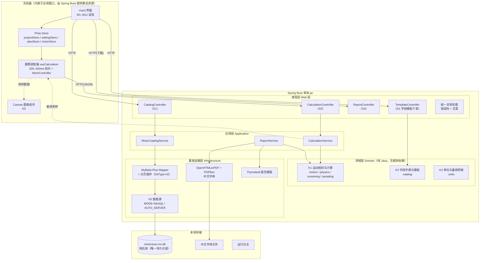
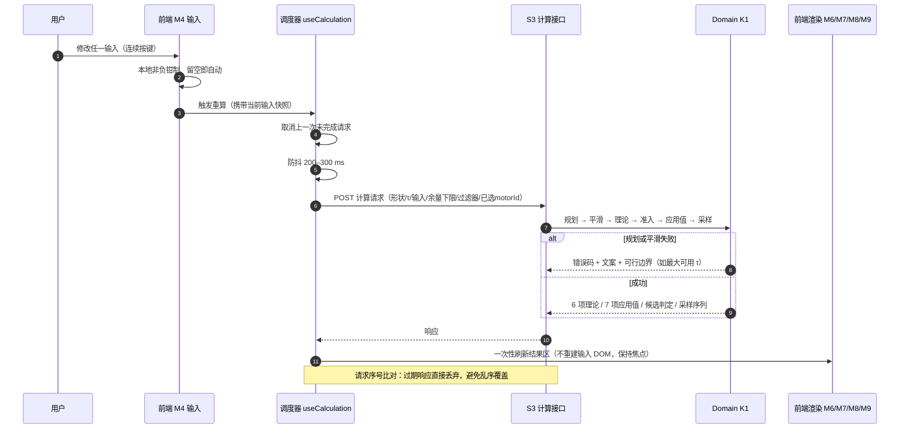
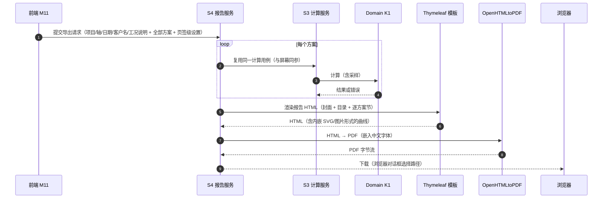
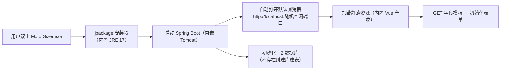
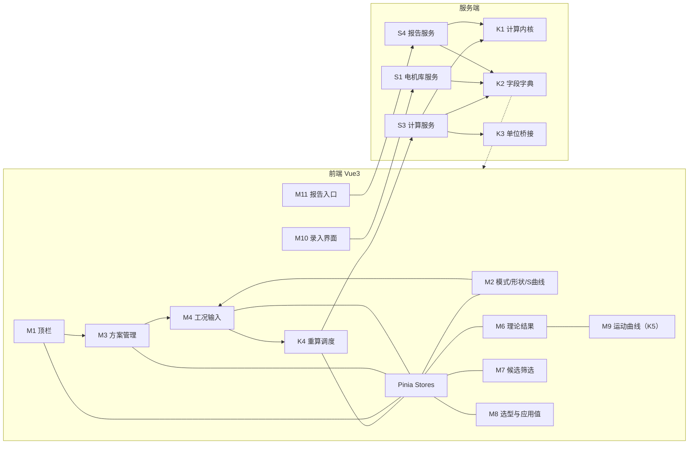

# 电机选型工具（MotorSizer）— 第二阶段：整体架构设计

| 项 | 内容 |
|---|---|
| 文档类型 | 总体设计 · 第二阶段产出（技术选型与整体框架设计） |
| 依据 | `doc/design/01.功能模块梳理.md`（19 项已闭合裁定）、`doc/requirements.md`（第 1–62 轮）、`prototype/`、`CLAUDE.md`（技术约束） |
| 本阶段边界 | **只确定整体方案**；不展开表结构、不定义接口字段、不编写业务代码 |
| 状态 | 待用户审核；技术选型与视觉边界共 21 项已确认，仅余 Q5–Q11 细节项 |

---

## 0. 阅读须知

1. 本设计的**一切模块**都来自第一阶段已确认的 M1–M11 / K1–K5 / S1–S4，**未新增任何业务功能**。凡新增内容均为技术实现手段，并在第 0.2 节逐条对应到已有模块。
2. 第 1–4 章的技术选型均已通过交互确认（见第 7 章「已确认决策记录」）；第 8 章列出的项目**尚未确认**，不得当作既定事实。
3. 本文不定义表结构与接口报文字段——那是第三、四阶段的工作；本文只界定**边界与职责**。

### 0.1 一句话架构

> **单体 jar（内置前端静态资源）+ 单一 H2 数据库文件 + 独立纯 Java 计算内核**，由 `jpackage` 打包为 Windows 安装包，双击即用；计算全部在服务端完成，前端负责输入、渲染与绘图。

### 0.2 第一阶段模块 → 本阶段技术落点

| 第一阶段 | 本阶段落点 | 层级 |
|---|---|---|
| M1 项目/轴信息 | `frontend/src/views/TopBar` + Pinia `projectStore` | 前端 |
| M2 运动模式/形状/S曲线 | `frontend/src/panels/ModePanel` + Pinia `settingStore` | 前端 |
| M3 方案管理 | `frontend/src/panels/CurvePanel` + Pinia `planStore` | 前端（会话级） |
| M4 工况输入 | `frontend/src/panels/InputPanel` + 双列表单组件 | 前端 |
| M5 安全余量门槛 | `frontend/src/panels/MarginPanel` + `settingStore` | 前端 |
| M6 理论结果 | `frontend/src/panels/ResultPanel`（消费计算接口） | 前端渲染 |
| M7 候选筛选 | `frontend/src/panels/CandidatePanel`（消费计算接口） | 前端渲染 |
| M8 选型与应用值 | `frontend/src/panels/MotorPanel` + `AppliedPanel` | 前端渲染 |
| M9 运动曲线 | `frontend/src/charts/*`（自研 Canvas 组件） | 前端 |
| M10 电机库 | `frontend/src/views/MotorEntryDialog` + 服务端 `S1` | 前端界面 + 服务端 |
| M11 报告导出 | `frontend/src/views/ReportDialog` + 服务端 `S4` | 前端入口 + 服务端 |
| K1 运动规划与计算 | `motorsizer-domain`（纯 Java 包，**不依赖 Spring**） | Domain |
| K2 字段字典 | `motorsizer-domain/catalog`（代码内定义） + `GET 字段模板` 接口 | Domain → 下发 |
| K3 单位与量纲桥接 | `motorsizer-domain/units` | Domain |
| K4 状态与重算调度 | 前端 Pinia + 防抖调度器（`useCalculation`） | 前端 |
| K5 图表渲染 | 前端 Canvas 组件（服务端提供采样数据） | 前端 |
| S1 电机库服务 | `motorsizer-app` 的 `catalog` 包（Controller/Service/Mapper） | Application |
| S2 工程数据服务 | **不建设**（Q3=A） | — |
| S3 计算服务 | `motorsizer-app` 的 `calculation` 包，编排 domain | Application |
| S4 报告服务 | `motorsizer-app` 的 `report` 包（Thymeleaf + OpenHTMLtoPDF） | Application |

---

## 1. 技术选型

### 1.1 选型总览

| 类别 | 选型 | 版本基线 | 依据 |
|---|---|---|---|
| 语言（后端） | Java | 17 LTS | `CLAUDE.md` 明确 Java；Spring Boot 3 最低要求 17 |
| 后端框架 | Spring Boot | 3.x | `CLAUDE.md` 明确 Spring Boot 3 |
| ORM | MyBatis-Plus | 3.5.x | `CLAUDE.md` 明确；H2 走 **MySQL 兼容模式**，无需自写方言 |
| 数据库 | **H2 文件模式** | H2 2.2.x | 用户二次裁定（T-5 改定，见 1.2.2 / R-1）：嵌入式、双击即用，且 MyBatis-Plus 适配成熟（MySQL 兼容模式） |
| 缓存 | **不引入** | — | 用户裁定移除 Redis：单用户无会话共享、电机库百条级、查询为简单过滤 |
| 对象存储 | **不引入** | — | 用户裁定移除 MinIO：v1 无文件上传（编码器不入库、样册识别为后续） |
| 计算内核 | 纯 Java（**无 Spring 依赖**） | — | 需要逐公式单测与「黄金用例」回归，不能与框架耦合 |
| 前端语言 | **TypeScript** | 5.x | 用户裁定（Q1）：计算响应结构复杂，需编译期字段校验 |
| 前端框架 | Vue 3 | 3.4+ | `CLAUDE.md` 明确 Vue3 |
| 前端服务方式 | Spring Boot 内嵌静态资源 | — | Q2（部署形态 A）已定单体 jar；P0-2 已定 C/S |
| 前端构建 | Vite | 5.x | Vue3 官方推荐，构建快、产物小 |
| 前后端构建集成 | `frontend-maven-plugin` | 1.15.x | 用户裁定（Q2）：`mvn package` 一步产出完整 jar |
| 前端状态 | **Pinia** | 2.x | 用户裁定；C-A「选中电机单点广播」需要集中式 store |
| UI 组件库 | Element Plus | 2.x | `CLAUDE.md` 明确；用户裁定 **T-12：全部控件采用 Element Plus 风格**（见 5.2 A-6 边界） |
| 图表 | **自研 Canvas 组件** | — | 用户裁定；图表需求固定（两条折线 + 参考线 + 阶段竖线 + 刻度点），原型已整合第 54 轮视觉方案 |
| HTTP 客户端 | axios | 1.x | 与 Element Plus 生态一致，支持 `AbortController` 取消 |
| 报告模板 | Thymeleaf | 随 Spring Boot | 服务端渲染 HTML，结构可读、与前端报告节结构可对照 |
| PDF 引擎 | **OpenHTMLtoPDF** | 1.0.x（LGPL） | 用户裁定：HTML/CSS → PDF，分页与样式可控且可商用；中文字体由 PDFBox 嵌入 |
| 接口文档 | Springdoc OpenAPI | 2.x | 生成接口契约，供第四阶段 API 设计验证 |
| 单测 | JUnit 5 + AssertJ | — | Domain 层逐公式测试 + 黄金用例 |
| 打包 | Maven + `frontend-maven-plugin` + **jpackage** | — | 用户裁定：Windows 安装包内置 JRE，真正双击即用 |

### 1.2 逐项选型依据

#### 1.2.1 为什么后端是「纯 Java 内核 + Spring 外壳」

第一阶段的横切约束 X-3（两阶段解耦）与 X-5（可复算优先）要求计算规则**可独立验证**。原型 `calc.js` 已经用 `_selftest.js` 做过一次验证（`m=8kg, S=1m, T=1s, θ=90° → 峰值 114.480 N、持续 83.804 N` 逐位一致）。

若把 K1 写在 Spring 的 `Service` 里，公式测试就要拉起容器、连数据库，验证成本急剧上升。因此架构上强制：

```
motorsizer-domain（纯 Java，无 Spring / 无 MyBatis / 无 Jackson 注解）
        ▲
        │ 单向依赖
motorsizer-app（Spring Boot：Controller / Service / Mapper / Report）
```

Domain 层**不出现任何框架注解**，输入输出用不可变值对象（record / 内部 DTO），这样同一套公式既能被 `S3 计算服务` 调用，也能被 `S4 报告服务` 复用（保证屏幕与报告同源），还能被单测逐条覆盖。

#### 1.2.2 为什么是 H2 文件模式而不是 MySQL / SQLite

| 维度 | MySQL 8 | H2 文件模式（选定） | SQLite |
|---|---|---|---|
| 部署 | 需独立服务/容器 | **文件，随 jar 启动** | 文件，随 jar 启动 |
| 「双击即用」 | ✗ 需先启动数据库 | **✓** | ✓ |
| 数据量（电机库百条级） | 富余 | 完全够用 | 完全够用 |
| MyBatis-Plus 适配 | 原生支持 | **成熟**（MySQL 兼容模式 `MODE=MySQL`） | **需自行适配** |
| 分页/主键/类型映射 | 原生 | 原生（兼容模式下） | 需方言插件 + 自定义策略 |
| 数据库工具兼容 | 最好 | 较好（可用通用 JDBC 工具） | 最好 |
| 后期迁移 MySQL | 目标 | 兼容模式下 DDL/DML 基本可直接迁 | 可导出为 SQL |

**裁定过程（T-5 两次改定）**：
1. 第一轮：由 MySQL（`CLAUDE.md`）改为 **SQLite**，理由是「双击即用」的部署形态；
2. 第二轮：风险评审发现 **MyBatis-Plus 对 SQLite 的方言/主键/类型映射需全套自行适配（R-1，高）**，用户裁定**改回 H2 文件模式**——同样是嵌入式单文件、同样双击即用，但 MP 适配成熟，风险归零。

偏离 `CLAUDE.md`（MySQL）已由用户明确裁定：改为 H2 文件模式，理由与「双击即用」的部署形态一致。

#### 1.2.3 H2 文件模式的配置要点

| 项 | 配置 | 说明 |
|---|---|---|
| 连接 URL | `jdbc:h2:file:.../motorsizer;MODE=MySQL;AUTO_SERVER=TRUE` | `MODE=MySQL` 让方言/DDL 贴近 MySQL，便于后期迁移；`AUTO_SERVER` 允许同一进程外工具连接查看 |
| 数据库文件 | `%APPDATA%\MotorSizer\motorsizer.mv.db`（+ `.trace.db`） | 单文件、随安装升级保留（A-5） |
| 建库建表 | 首次启动执行 `schema.sql`（`spring.sql.init.mode=always` + 幂等 DDL） | 空库启动即建表（Q3=A：不预置数据） |
| 主键 | `BIGINT AUTO_INCREMENT`（MySQL 兼容模式） | `IdType.AUTO`，无需自定义策略 |
| 分页 | MyBatis-Plus 内置 `PaginationInnerInterceptor` + `DbType.H2` | 无需自写方言 |
| 类型映射 | `VARCHAR` / `REAL` / `TIMESTAMP` | 与 MySQL 语义一致，迁移成本低 |
| 事务/锁 | H2 默认 MVStore 引擎 | 单用户场景足够；`AUTO_SERVER` 模式下有文件锁保护 |

> **成本提示（R-1 残余）**：H2 的文件格式（`.mv.db`）为 H2 专属，用户无法像 SQLite 那样用通用工具直接打开；Q4 已定「v1 不做备份功能，仅文档写明路径」，用户复制该文件即可备份，恢复时**必须保证应用未运行**（文件被占用）。

#### 1.2.4 为什么 PDF 用「HTML 模板 → 转 PDF」而不是直接用 OpenPDF 编排

报告结构为「封面 + 方案目录 + N 个方案节，每节含表格与两张图，每条方案另起一页」，属于**强排版文档**。

| 方案 | 分页控制 | 样式维护 | 与前端报告一致性 | 许可 |
|---|---|---|---|---|
| **Thymeleaf + OpenHTMLtoPDF（选定）** | CSS `@page` / `break-before: page` | HTML+CSS，直观 | 报告节结构与前端 `ReportDialog` 可逐节对照 | LGPL（可闭源商用） |
| OpenPDF API 逐格绘制 | 代码里算坐标 | 改样式即改代码 | 难对照 | LGPL |
| iText 7 | 好 | 好 | 好 | **AGPL**：闭源需商业授权 |

#### 1.2.5 为什么图表自研而不引 ECharts

原型 `chart.js` 仅 9.5KB，且第 54 轮已做过完整视觉重构（渐变描边、面积填充、白心数据点、峰值胶囊标签、阶段虚线、能力参考线白底标签）。这些定制项在 ECharts 里需要大量 `custom series` 配置，反而更难维护。图表需求固定且简单：

- 两条折线（速度-时间、力/力矩-时间）
- 水平参考线（用户速度上限、电机连续/峰值能力）
- 竖直线（阶段分界）+ 横轴刻度点
- 无交互（无缩放、无 tooltip 拖拽）

代价是需要自行处理 DPR 与尺寸自适应（原型已有 `resize` 监听，可直接迁移）。

#### 1.2.6 为什么前端状态必须用 Pinia（而不是组件内 ref）

第一阶段的耦合点 **C-A「选中电机的单点广播」**：一次 `motorId` 写入要同时刷新 5 处（M8 参数表、M8 应用值 7 项、M6 安全余量卡片、M9 能力参考线、M11 报告）。若状态分散在组件里，必然出现「列表已选、结果未变」的假象。Pinia 提供单一 store + 响应式订阅，天然满足。

---

## 2. 整体架构设计

### 2.1 系统架构图



### 2.2 技术分层与职责

| 层 | 内容 | 职责 | 禁止 | 对应模块 |
|---|---|---|---|---|
| **表现层** | Controller + DTO + 异常处理 | 接收 HTTP、参数格式校验、调用应用层、组装响应；统一错误码 | 禁止写业务规则、禁止直接访问 Mapper | S1/S3/S4 接口 |
| **应用层** | Service | 编排用例：加载候选池 → 调 Domain 计算 → 组装可解释结果 → 转 DTO | 禁止写公式、禁止写 SQL | S1/S3/S4 编排 |
| **领域层** | Domain 包 | **全部业务规则与公式**：K1 规划/力学/判定/采样、K2 字段字典、K3 单位 | **禁止引入 Spring / MyBatis / Web 依赖** | K1/K2/K3 |
| **基础设施层** | Mapper / PDF / 模板 / 数据源 | 持久化、PDF 渲染、字体加载、连接池 | 禁止写业务规则 | 存储与输出 |
| **前端** | Vue 视图 + Pinia + 调度 + Canvas | 输入收集、状态归属、结果渲染、图表绘制、防抖调度 | 禁止在前端复刻任何计算公式（Q2 已定服务端唯一实现） | M1–M11、K4、K5 |

> **一条硬约束**：**计算公式只能存在于 `motorsizer-domain`**。前端不得实现任何公式（含 X-7 显示精度的「1 位小数 / 退 3 位」规则——该规则由服务端返回的格式化结果或统一格式化工具驱动，避免两端不一致）。

### 2.3 前后端协作方式

#### 2.3.1 计算请求时序（含防抖与取消）



**关键规则：**

| 规则 | 说明 | 依据 |
|---|---|---|
| 输入不发请求的部分 | 非负钳制、留空即自动、方向↔倾斜角回写、单位显示换算：纯 UI 行为，前端处理 | 第一阶段 X-6、M4 职责 |
| 一次请求一次全量 | 规划/理论/判定/应用值/采样**同一响应**返回，禁止前端串联多次请求 | Q2-a |
| 过期响应丢弃 | 请求带递增序号，响应序号小于当前则丢弃 | 防乱序（新增技术手段） |
| 错误也走同一响应 | 失败返回 `stage` + 错误码 + 文案，前端在 M6 卡片区展示 | 4.2 关键分支 |

#### 2.3.2 报告生成时序



> **报告与屏幕同源的保证方式**：S4 **不重新实现任何计算**，而是复用 `CalculationService` 的同一用例与 Domain 的同一份采样数据；曲线图在报告里由服务端按采样数据重绘（SVG 或 PNG），**不与前端 Canvas 共享渲染代码，但共享数据**。

#### 2.3.3 启动与运行形态



| 项 | 方案 |
|---|---|
| 端口 | **自动选空闲端口**（建议，待 Q7 确认），启动后把实际地址显示在窗口与日志 |
| 数据库位置 | `%APPDATA%\MotorSizer\motorsizer.mv.db`（A-5），随安装升级保留；用户可自行复制该文件备份（Q4=A） |
| 单实例 | 启动时尝试绑定本地锁；已运行则直接打开浏览器指向既有实例（防两进程写同一库，A-4） |
| 无鉴权 | 第一阶段 Q1 已定单用户、无账号体系；仅监听 `127.0.0.1`，不监听外网网卡（A-3） |
| 首次启动 | 电机库为空（Q3=A），M7 推荐列表显示空状态引导「请先录入电机」 |

---

## 3. 模块架构设计

### 3.1 模块在系统中的位置



### 3.2 各模块职责与依赖（落位表）

| 模块 | 所在位置 | 职责 | 依赖 | 被依赖 |
|---|---|---|---|---|
| **M1** 项目/轴信息 | `frontend/views/TopBar` | 项目名/轴名/日期/页签切换/两个动作入口 | `projectStore` | M11 |
| **M2** 模式/形状/S曲线 | `frontend/panels/ModePanel` | 模式与 τ 的页签级状态 | `settingStore` | K4 调度 |
| **M3** 方案管理 | `frontend/panels/PlanPanel` | 方案列表增删翻页 | `planStore` | K4、M11 |
| **M4** 工况输入 | `frontend/panels/InputPanel` | 双列输入、三态、钳制、方向回写 | `planStore`、字段模板接口 | K4 |
| **M5** 安全余量门槛 | `frontend/panels/MarginPanel` | 上下限阈值 | `settingStore` | K4（作为请求参数） |
| **M6** 理论结果 | `frontend/panels/ResultPanel` | 6 卡片渲染 + 错误展示 | 计算响应 | — |
| **M7** 候选筛选 | `frontend/panels/CandidatePanel` | 过滤器 chip + 列表渲染 | 计算响应 | M8（选中源） |
| **M8** 选型与应用值 | `frontend/panels/MotorPanel` + `AppliedPanel` | 选中电机（单点写入）、参数表、7 项应用值 | 计算响应、字段模板 | M6 卡片5、M9 参考线、M11 |
| **M9** 运动曲线 | `frontend/charts/` | 两张曲线绘制 | 计算响应中的采样 | — |
| **M10** 电机库 | `frontend/views/MotorEntryDialog` + 服务端 S1 | 录入表单（模板驱动）+ 持久化 | K2 模板下发 | M7 候选池 |
| **M11** 报告 | `frontend/views/ReportDialog` + 服务端 S4 | 报告弹窗 + PDF 下载 | M1、M3、计算服务 | — |
| **K1** | `domain/motion`, `physics`, `screening`, `sampling` | 全部公式 | K3 | S3、S4 |
| **K2** | `domain/catalog` | 三套模板、`req`、`factor`、冷却占位 | — | S1、S3、S4、M10、M8 |
| **K3** | `domain/units` | 单位换算 | — | K1、前端显示 |
| **K4** | `frontend/composables/useCalculation` | 防抖、取消、序号比对、状态归属 | M2/M4/M5、计算接口 | 全部结果面板 |
| **K5** | `frontend/charts/` | Canvas 绘制 | 采样数据 | M9、报告预览 |
| **S1** | `app/catalog` | 电机库 CRUD、主键唯一、必填强制 | K2、Mapper | M7/M10 |
| **S3** | `app/calculation` | 编排 K1、组装可解释结果 | K1/K2/K3、S1 | M6/M7/M8/M9、S4 |
| **S4** | `app/report` | 逐方案计算 + HTML→PDF | S3、Thymeleaf、PDF | M11 |

### 3.3 三个耦合点在架构上的处置

| 耦合点 | 架构处置 |
|---|---|
| **C-A 选中电机单点广播** | `motorStore.selectedMotorId` 为唯一写入口；M8 参数表、M8 应用值、M6 卡片5、M9 参考线均订阅该 store；M11 由 store 读取并随请求发送 |
| **C-B 入库门槛 = 准入门槛** | K2 的 `FieldSpec.req` 是唯一来源：S1 保存校验读它，S3 准入判定读它，M10 表单必填星标由**同一份下发模板**渲染 |
| **C-C 两套余量口径** | Domain 中定义两个**命名不同**的值对象字段：`headroomRatio`（列表 Safety）与 `safetyPercent`（应用值安全系数），并在 API 契约里要求 DTO 字段名区分，禁止都叫 `margin` |

---

## 4. 项目目录设计

### 4.1 仓库结构

```
MotorSizer/
├── pom.xml                                  # Maven 聚合父工程（统一版本、依赖管理）
├── CLAUDE.md / README.md
│
├── doc/                                     # 设计与规范文档
│   ├── requirements.md
│   ├── rules/
│   │   ├── database-rules.md                # ⚠ 当前为空，第三阶段前须成文
│   │   └── api-rules.md                     # ⚠ 当前为空，第四阶段前须成文
│   └── design/
│       ├── 01.功能模块梳理.md
│       ├── 02.整体架构设计.md                # 本文
│       ├── 03.计算内核规格.md                # 待产出
│       ├── 04.数据库设计.md                  # 待产出
│       ├── 05.API接口设计.md                 # 待产出
│       └── 06.电机库与字段字典设计.md         # 待产出
│
├── prototype/                               # 现有前端原型（只读参照，不参与构建）
│
├── motorsizer-domain/                       # ★ 纯 Java 计算内核（无框架依赖）
│   ├── pom.xml                              # 仅依赖 JUnit（test scope）
│   └── src/
│       ├── main/java/com/motorsizer/domain/
│       │   ├── units/                       # K3 单位与量纲桥接
│       │   ├── motion/                      # K1 规划：点到点、自定义反解、S 曲线上抬
│       │   ├── physics/                     # K1 力/力矩、循环 RMS、热、电压
│       │   ├── screening/                   # K1 准入①②、余量、排序
│       │   ├── sampling/                    # K1 曲线采样（v1 均匀 241 点，含两端）
│       │   ├── catalog/                     # K2 三套字段模板、req、factor、派生项
│       │   └── model/                       # 不可变值对象（输入/结果/错误）
│       └── test/java/com/motorsizer/domain/
│           ├── golden/                      # 黄金用例（对照原型软件数值）
│           └── ...                          # 逐公式单测
│
├── motorsizer-app/                          # Spring Boot 应用（打包入口）
│   ├── pom.xml
│   └── src/
│       ├── main/java/com/motorsizer/app/
│       │   ├── MotorsizerApplication.java
│       │   ├── controller/                  # 表现层：S1/S3/S4/K2 模板接口
│       │   ├── service/                     # 应用层编排
│       │   ├── mapper/                      # MyBatis-Plus Mapper
│       │   ├── entity/                      # 数据库实体
│       │   ├── dto/                         # 请求/响应对象（不含公式）
│       │   ├── report/                      # S4：报告组装
│       │   ├── config/                      # 数据源（H2 MODE=MySQL）、MyBatis-Plus 分页插件、字段模板、PDF 字体
│       │   └── common/                      # 统一异常、错误码枚举、常量
│       ├── main/resources/
│       │   ├── application.yml
│       │   ├── db/schema.sql                # 建表（第三阶段产出）
│       │   ├── report-templates/            # Thymeleaf 报告模板
│       │   ├── fonts/                       # 中文字体（PDF 嵌入）
│       │   └── static/                      # ★ 前端构建产物（由构建流程拷入）
│       └── test/java/...
│
├── frontend/                                # Vue3 + TypeScript 前端工程
│   ├── package.json / vite.config.ts / tsconfig.json
│   └── src/
│       ├── api/                             # 接口封装（统一请求/取消/错误处理）
│       ├── types/                           # ★ 接口契约类型、字段模板类型（与后端 DTO 对齐）
│       ├── stores/                          # Pinia：project/setting/plan/motor
│       ├── composables/                     # useCalculation（防抖+取消+序号）
│       ├── views/TopBar/                    # M1
│       ├── panels/                          # M2–M8 各面板
│       ├── dialogs/                         # M10 录入、M11 报告
│       ├── charts/                          # K5 Canvas 折线组件
│       ├── components/                      # 通用：数值输入、chip、指标卡、图例
│       ├── styles/                          # 原型样式迁移（变量化）
│       └── main.ts
│
├── packaging/                               # jpackage 打包配置
│   ├── windows/                             # 启动参数、图标、安装器配置
│   └── build.sh|bat                         # 一键：构建前端 → 构建 jar → jpackage
│
└── scripts/                                 # 开发辅助
    ├── dev.sh|bat                           # 前端 dev + 后端 dev 并行
    └── build.sh|bat                         # 全量构建
```

### 4.2 目录用途简表

| 目录 | 用途 | 关键约束 |
|---|---|---|
| `motorsizer-domain` | 全部业务公式与规则 | **不得引入 Spring/MyBatis/Jackson-Web 依赖**；测试覆盖率是验收门槛 |
| `motorsizer-app` | 接口、编排、持久化、报告 | Controller 不含公式；Service 不含 SQL |
| `app/resources/static` | 前端产物落点 | 由构建脚本从 `frontend/dist` 拷贝，**不手工编辑** |
| `app/resources/report-templates` | 报告 HTML 模板 | 分页规则写在 CSS（`@page`、`break-before`） |
| `app/resources/fonts` | PDF 中文字体 | 字体许可需可商用（见风险 R-4） |
| `frontend/panels` | 与第一阶段 M2–M8 一一对应 | 面板不直接发请求，统一走 `useCalculation` |
| `frontend/stores` | K4 状态归属 | 页签级与方案级状态分 store，避免混放 |
| `packaging` | jpackage 配置 | Windows 专属产物 |
| `prototype` | 原型参照 | **不参与构建**，仅作视觉与交互对照 |

### 4.3 原型 → 新工程的迁移映射

| 原型文件 | 迁移去向 | 说明 |
|---|---|---|
| `prototype/js/calc.js`（630 行） | `motorsizer-domain`（motion/physics/screening/sampling/units） | **逐函数迁为 Java**，行为必须等价；作为黄金用例对照的基准 |
| `prototype/js/data.js` 中 `motorFieldGroups` | `domain/catalog`（K2） | 字段模板、`req`、`factor`、`{cool}` 占位 |
| `prototype/js/data.js` 中 `motors` 示例库 | **不进入产品**（Q3=A 空库） | 仅作为测试夹具迁入 Domain 单测；产品首次启动为空库 + 引导文案 |
| `prototype/js/chart.js` | `frontend/charts`（Vue 组件化） | 保留第 54 轮视觉方案 |
| `prototype/js/app.js` 渲染逻辑 | `frontend/panels` + `stores` | 拆为视图与状态 |
| `prototype/css/style.css` | `frontend/styles`（CSS 变量化） | 保留三列布局与配色 |
| `prototype/_selftest.js` | `motorsizer-domain` 的 `golden` 测试 | 用例逐条转为 JUnit |

---

## 5. 关键设计决策

### 5.1 已确认的技术决策（本轮交互确认）

| # | 决策 | 裁定 | 影响 |
|---|---|---|---|
| T-1 | Redis / MinIO | **都移除** | 架构与部署最简；无缓存层与对象存储层 |
| T-2 | 部署形态 | **单体 jar 内置前端** | 前端构建产物进 `static/`；无 Nginx |
| T-3 | PDF 方案 | **HTML/CSS 模板 → PDF（OpenHTMLtoPDF）** | 新增 Thymeleaf + 字体资源 |
| T-4 | 字段字典 | **代码内定义 + API 下发** | K2 在 domain，不建字典表；模板变更需发版 |
| T-5 | 数据库 | **H2 文件模式**（初定 SQLite，风险评审后改定） | 嵌入式 `MODE=MySQL`；MyBatis-Plus 原生适配 |
| T-6 | 图表 | **自研 Canvas 组件** | 不引 ECharts；需迁移原型绘制代码 |
| T-7 | 采样密度 | **固定 241 点（240 等分区间，含起止两端）；v1 均匀采样**；S 曲线斜坡局部加密推迟到后续版本（2026-11-18 复核） | 响应约 30KB/次；与冻结原型逐点对齐，黄金快照可直接回归 |
| T-8 | ORM 适配 | **MyBatis-Plus 原生 + `DbType.H2`**（原定自写 SQLite 方言，已随 T-5 取消） | 无需自定义方言；迁移 MySQL 只需改 URL 与方言类型 |
| T-9 | 交付产物 | **jpackage 打包 exe（内置 JRE）** | Windows 专属；构建链多一步 |
| T-10 | 前端状态 | **Pinia** | C-A 单点广播有落点 |
| T-11 | 后端分层 | **Controller–Service–Domain–Mapper 四层** | Domain 可独立单测；代码分两个 Maven 模块 |

### 5.2 本阶段自行作出的架构约定（需用户认可，非需求新增）

| # | 约定 | 依据 | 若不认可的影响 |
|---|---|---|---|
| A-1 | 计算公式**只存在于 domain**，前端不复刻 | Q2「服务端统一计算」+ X-5「可复算优先」 | 若前端也要算，需说明理由并防两套漂移 |
| A-2 | 请求带**序号**，过期响应丢弃 | Q2-a 防抖的必要配套（否则乱序覆盖） | 无替代方案；这是纯技术保障 |
| A-3 | 只监听 `127.0.0.1` | Q1 单用户、无鉴权；避免局域网裸奔 | 若需局域网访问，须补鉴权（新增需求） |
| A-4 | 单实例锁 | 防两个进程写同一 H2 数据库文件 | 无替代方案 |
| A-5 | 数据库文件在 `%APPDATA%` 而非安装目录 | 卸载/升级不丢库；安装目录可能无写权限 | 位置可调，但需明确 |
| A-6 | **Element Plus 全量替换控件风格**，但**三列布局与面板结构保持不变** | 用户裁定（T-12）：控件（输入/下拉/滑块/按钮/弹窗/消息）全部采用 Element Plus；需求 8.2 的分区与顺序不推翻 | 影响下一阶段的界面视觉设计，需以 Element Plus 为基准重做样式层 |

### 5.2.1 Element Plus 全量化的视觉边界（第 5–6 轮裁定，下一阶段的设计前提）

> 背景：用户裁定「全量换 Element Plus 风格」，但需求 8.2 已定死三列分区与面板顺序，需求 4.1 / 第 25 轮已定死数值归属三色规则，第 54 轮已定死图表视觉。三者必须共存，故划出边界。

| 维度 | 处置 | 依据 |
|---|---|---|
| **三列布局与面板顺序** | **保持不变**（左：运动模式→方案管理→用户输入；中：安全余量→理论结果→实际应用值；右：推荐/选入→运动曲线） | 需求 8.2；用户裁定「布局与面板结构不变」 |
| **控件（输入框、数字输入、下拉、单选、复选、滑块、按钮、弹窗、消息提示）** | **全部使用 Element Plus 组件** | 用户裁定（T-12） |
| **数值归属三色规则** | **规则保留**：用户输入=中性、理论计算值=「理论值」色、实际应用值=「实际值」色；**色值改为适配 Element Plus 色板的对应色** | 用户裁定；需求 4.1 / 第 25 轮 |
| **「理论值」徽标与「留空自动」占位** | 保留（可改用 Element Plus `el-tag` 呈现） | 需求 4.1、8.2 |
| **面板/卡片/chip/指标卡** | 采用 Element Plus 的卡容器、标签、按钮组等**组件形态**，但**保留原型的信息组织结构**（如 6 张指标卡、双列输入表、类型徽标行） | 需求 8.2 内容清单不变 |
| **图表（M9 两张曲线）** | **不受 Element Plus 影响**，保留自研 Canvas 与第 54 轮视觉（渐变描边、面积填充、白心数据点、胶囊标签、阶段虚线、能力参考线） | 用户裁定「保留自研 Canvas 视觉」 |
| **整体配色基调** | 以 Element Plus 默认主题（或自定义主题变量）为基准；原型的蓝色系可映射到主题色 | 用户裁定 |
| **字号/字重规则（第 57 轮：13px Bold，不做描边）** | 保留；仅当 Element Plus 主题变量与之一致时可直接沿用 | 第 57 轮的实测结论（微软雅黑只有 Regular/Bold 两档） |

> **一句话**：**换控件皮肤、不换信息架构；图表保持原样。** 下一阶段的「页面与交互设计」应以 Element Plus 为视觉基准重做样式层，但不得改动 8.2 的分区与 4.1 的颜色语义。

### 5.3 潜在风险

| # | 风险 | 等级 | 影响 | 应对 |
|---|---|---|---|---|
| ~~**R-1**~~ | ~~MyBatis-Plus 对 SQLite 的方言/主键/类型映射适配不足~~ | ~~高~~ | — | **已消除**（用户裁定改回 H2 文件模式，MySQL 兼容模式下 MP 原生适配）。**残余**：H2 文件格式为 H2 专属，通用数据库工具兼容性不如 SQLite（低） |
| **R-2** | **原型 JS 内核迁移为 Java 的等价性** | **高** | 一处浮点/取整差异即导致「结果与原型不一致」，破坏可复算承诺 | **双轨对照（用户裁定）**：①保留原型 `calc.js` 作为**基准计算器**（仅用于测试，不进产品）；②迁移后对一批工况自动跑「Java 输出 vs JS 输出」对比，容差 1e-9 相对误差；③另把已对齐参考软件的数值（峰值 114.480 N、持续 83.804 N 等）作为**黄金用例**独立断言；④显示层格式化规则（1 位小数 / 退 3 位）单独测试。**落地方式（2026-11-18 裁定）：快照冻结** —— 用 Node 一次性跑 `calc.js` 生成期望值快照 JSON（入 git），Java 单测只读快照比对；构建链与 `motorsizer-domain` **不依赖 Node**；生成脚本 `scripts/gen-golden.js` 入库，原型 `calc.js` 冻结为基线，改动后必须重生成快照 |
| **R-3** | jpackage 打包的复杂度（内置 JRE、图标、安装器签名） | 中 | 打包失败或缺少模块 | ①先跑通 `jar` 形态；②单独验证 jpackage 模块裁剪后 H2/PDF 相关包是否齐备；③未签名 exe 会有安全提示（内部使用可接受）。**注**：改 H2 后不再有 sqlite-jdbc native 库问题。**交付形态（2026-11-18 裁定）：免安装绿色包** —— `jpackage --type app-image` 产出目录（内含 jlink 裁剪 JRE + 主 exe），双击即用、免管理员权限、不写注册表；关闭条件 = 无 JRE 干净机器上解压双击可启动并读到 `%APPDATA%` 库文件。**体积预期（含 OCR）**：基础包 90–110MB；**OCR 采用 PP-OCRv6 small + ONNX Runtime（全离线）**，代价 = 模型 30MB + onnxruntime jar 89MB，其中非 win-x64 原生库与全部 `.pdb`/`.dSYM` 由 `packaging/windows/jar_slim.py` 在打包时裁掉（fat jar 181.8→97.5MB）。关闭条件追加「干净机器上 OCR 可加载并正确识别一张位图参数表」 |
| **R-4** | PDF 中文字体许可 | 中 | 商用交付时字体侵权 | 选用可商用字体（如思源黑体/Noto Sans SC，OFL）并记录许可。**裁定（2026-11-18）：Noto Sans SC Regular 全量嵌入**（OFL 1.1，可商用可嵌入可随包分发），包内 +约 10–14MB；PDF 仍按实际用字子集嵌入，报告文件不受影响；关闭条件 = 干净机器生成的 PDF 中中文无豆腐块 |
| **R-5** | 防抖 + 服务端计算的响应延迟感 | 中 | 输入手感不如原型的纯本地计算 | ①前端对**纯 UI 行为**（钳制、留空、显示单位换算）即时响应；②仅数值结果等防抖；③可加「计算中」轻提示。**裁定（2026-11-18）：输入变化后 150ms 防抖；滑块拖动期间 80ms 节流、松手立即补一次；配合 A-2 序号丢弃过期响应 + `AbortController` 取消上一请求** |
| **R-6** | 会话级数据关页即失（Q3=A） | 中 | 用户误关窗口丢失全部工况 | **已处置（第 65 轮裁定）**：监听 `beforeunload`，存在已填工况时弹窗提示「关页后工况将丢失」。**不持久化、不推翻第 35 轮**，只加一道防线。前端需定义「有未保存内容」的判定口径（建议：任一方案的 `load`/`distance` 非空） |
| **R-7** | 无鉴权 + 若误配监听外网 | 中 | 局域网内任意人可改电机库 | A-3 只绑 `127.0.0.1`；安装器不改默认 |
| **R-8** | 报告逐方案重算的性能 | 低 | 方案多时导出变慢 | 方案数通常 < 20；必要时并行计算但**不缓存**（避免与屏幕结果不同步） |
| **R-9** | **Element Plus 全量化的视觉迁移成本** | 中 | 第 54/57/61 轮的定制视觉需按 Element Plus 重做；若处理不当会丢掉信息层级（如"理论值紫色"与"实际值青色"的区分） | **先出映射表再动代码（用户裁定）**：①下一阶段先产「原型元素 → Element Plus 组件 + 色值映射」表（含 6 张指标卡、双列输入表、chip、类型徽标、三色语义），审核通过后再写样式；②以 5.2.1 边界表为准：只换皮肤不换信息架构；③图表保持自研视觉 |
| **R-10** | Element Plus 与自研 Canvas 的视觉割裂 | 低 | 控件是 Element Plus 风格、图表是原型风格，可能显得不协调 | 图表配色从 Element Plus 主题色派生（主色、成功色、警示色），保证同一套色板 |

---

## 6. 与后续阶段的衔接

| 后续产出 | 本阶段已定前提 | 仍需回答 |
|---|---|---|
| 03 计算内核规格 | Domain 纯 Java、K1/K2/K3 分包、采样 241 点（含两端） | 全部公式与边界、错误码清单、格式化规则 |
| 04 数据库设计 | H2 文件模式（`MODE=MySQL`）、只建电机域、主键 `型号名+配置名` | 表结构、字段类型映射、索引、建表脚本、**须先成文 `database-rules.md`** |
| 05 API 接口设计 | 4 个接口族（字段模板/计算/电机库/报告）、整体计算一次返回 | 接口字段、错误码契约、**须先成文 `api-rules.md`** |
| 06 电机库与字段字典 | 代码内定义、API 下发、三套模板 | 模板结构体、派生项规则、录入校验清单 |
| 前端页面与交互 | 三列布局与面板顺序不变；Element Plus 全量控件；三色规则保留；图表自研 | 逐面板做「原型 → Element Plus」映射（含 6 卡片、双列输入表、chip、类型徽标）；空/错/加载态；常见分辨率适配 |

---

## 7. 已确认决策记录（本轮交互）

| 轮次 | 问题 | 用户裁定 |
|---|---|---|
| 1 | Redis / MinIO | **A：两者都移除** |
| 1 | 部署形态 | **A：单体 jar 内置前端** |
| 1 | PDF 方案 | **A：HTML/CSS 模板 → PDF（OpenHTMLtoPDF）** |
| 1 | 字段字典 | **A：代码内定义 + API 下发** |
| 2 | 数据库 | **C：SQLite** → 第 7 轮**改定为 H2 文件模式**（见下行） |
| 2 | 图表库 | **A：自研 Canvas 组件** |
| 2 | 采样密度 | **A：240 点，S 曲线局部加密** → 2026-11-18 复核改定为 **241 点（240 等分区间，含两端）+ v1 均匀采样** |
| 3 | ORM 适配 | **A：MyBatis-Plus + 自定义 SQLite 方言** → 随 T-5 改定后**改为原生适配**，无需自定义方言 |
| 3 | 交付产物 | **B：jpackage 打包 exe（内置 JRE）** |
| 3 | 前端状态 | **A：Pinia** |
| 3 | 后端分层 | **A：Controller–Service–Domain–Mapper 四层** |
| 4 | 前端语言 | **A：TypeScript** |
| 4 | 构建集成 | **A：frontend-maven-plugin 全自动** |
| 4 | 电机库初始化数据 | **A：空库 + 引导文案** |
| 4 | 电机库备份/恢复 | **A：v1 不做，仅在文档写明路径** |
| 5 | Element Plus 范围 | **B：全量替换控件风格**（布局与面板结构不变，见第 6 轮边界裁定） |
| 5 | 数据库文件位置 | **A：`%APPDATA%\MotorSizer`** |
| 5 | 端口策略 | **A：自动选空闲端口 + 自动开浏览器** |
| 6 | 布局与面板结构边界 | **A：布局与面板结构不变，只换控件风格** |
| 6 | 数值归属颜色图例 | **A：保留三色规则，色值适配 Element Plus 色板** |
| 6 | 图表视觉 | **A：保留自研 Canvas 视觉，不受 Element Plus 影响** |
| 7 | 视觉边界复核 | **A：换控件皮肤，不换信息架构**（与 5.2.1 一致，确认成立） |
| 7 | R-1 处置 | **B：改回 H2 文件模式**（风险归零，`MODE=MySQL`） |
| 7 | R-2 处置 | **A：双轨对照**（保留 JS 内核作测试基准 + 黄金用例） |
| 7 | R-9 处置 | **A：下一阶段先出映射表再动代码** |
| 风险复核 | R-2 落地方式 | **快照冻结**（Node 生成快照入 git，Java 单测读快照；构建链不依赖 Node） |
| 风险复核 | R-3 交付形态 | **免安装绿色包**（`app-image` + jlink 裁剪 JRE） |
| 风险复核 | R-4 字体 | **Noto Sans SC Regular 全量嵌入**（OFL） |
| 风险复核 | R-5 触发策略 | **150ms 防抖 + 滑块 80ms 节流 + `AbortController`** |
| 风险复核 | R-11/R-12/R-13 | **按现有防线关闭**（C3 白名单 + 事务 + `03` §6.4 回归单测），不加启动自检、不加前端判别联合 |

> **共 25 项技术决策已确认**，第二轮架构、视觉边界与三大风险处置策略均无阻塞项；**2026-11-18 风险复核追加 5 项裁定**，R-2/R-3/R-4/R-5/R-11/R-12/R-13 全部关闭。Q5–Q11 为细节项（加密、诊断日志、高 DPI、深色模式、自动更新、错误码体系），已给建议，可在第三、四阶段按需调整。

---

## 8. 待确认问题

> 以下均**未获确认**，不得当作既定事实。按优先级分两批，本轮先问 Q1–Q4。

### 8.1 第一批确认记录（已定）

| # | 问题 | 用户裁定 | 落地影响 |
|---|---|---|---|
| **Q1** | 前端语言 | **A：TypeScript** | `frontend` 增加 `tsconfig.json`、`src/types/`（接口契约类型、字段模板类型）；API 层返回类型强约束 |
| **Q2** | 构建集成 | **A：`frontend-maven-plugin` 全自动** | `mvn package` 自动执行 `npm ci && npm run build` 并拷贝 `dist` 到 `static/`；首次构建需下载 node/npm（离线环境需预置） |
| **Q3** | 电机库初始化数据 | **A：空库 + 引导文案** | 不预置任何电机数据；空库时 M7 显示空状态引导「请先录入电机」；演示数据仅存在于 `prototype/`，不进入产品 |
| **Q4** | 电机库备份/恢复 | **A：v1 不做，文档写明路径** | 不增加接口与界面；文档注明数据库文件位置（`%APPDATA%\MotorSizer\motorsizer.mv.db`），用户可自行复制备份 |

> **Q3 的连带影响**：原型中「ILM-20-050 故意缺 Kth/Tmax 用于演示信息不全」等演示意图，在产品空库下不可见。这些演示用例转而在 `motorsizer-domain` 的**单元测试**中保留（作为判定分支的测试夹具），不影响产品行为。

### 8.2 第二批待确认（细节，可在第三、四阶段定）

| # | 问题 | 说明 | 建议 |
|---|---|---|---|
| Q5 | 数据库加密 | **A（第 65 轮确认）：不加密**。理由：单用户本机、无网络暴露；库内只有厂商公开参数、无敏感信息；加密会牺牲 `AUTO_SERVER`（无法用工具排查），且密码需存于配置等于无效加密 | — |
| Q6 | 诊断日志导出 | 用户报错时能否一键导出日志（服务端已有日志，前端错误在浏览器控制台） | 建议 v1 仅落日志文件，不做导出入口 |
| Q7 | 端口策略 | 固定端口（可预期、便于排查）vs 自动选空闲端口（避免冲突） | **建议自动选空闲端口 + 启动后把实际地址显示在窗口/日志** |
| Q8 | 高 DPI 适配 | Canvas 在高分屏需按 `devicePixelRatio` 缩放，否则曲线模糊 | 技术上必做（不涉及需求变更） |
| Q9 | 深色模式 | 原型只有浅色；需求未提 | 建议 v1 不做 |
| Q10 | 自动更新 | 需求未提；升级时需保留数据库 | 建议 v1 不做，安装包覆盖安装时保留 `%APPDATA%` 数据 |
| Q11 | 错误码体系 | 需在第四阶段 API 设计前定，并同时写入 `api-rules.md` | 建议错误码按「阶段 + 类别」分段（如 `PLAN_*` / `SMOOTH_*` / `SCREEN_*` / `CATALOG_*`） |

---

## 9. 本阶段快照

**已确认**

1. 系统为**单体 jar**：Spring Boot 内置 Vue 静态资源，无 Nginx、无 Redis、无 MinIO。
2. **H2 文件模式**为唯一持久化数据库，只存电机库；工程数据为会话级。
3. 后端**四层**：Controller–Service–**Domain（纯 Java 计算内核）**–Mapper。
4. 前端 Vue3 + TypeScript + Vite + **Pinia** + **Element Plus（全量控件风格）** + **自研 Canvas 图表（不受 Element Plus 影响）**。
5. **视觉边界**（关键）：换控件皮肤、**不换信息架构**——三列布局与面板顺序、数值归属三色规则、图表视觉全部保留（见 5.2.1）。
6. 计算全部在服务端，前端防抖 200–300 ms 并丢弃过期响应。
7. 报告由 **Thymeleaf + OpenHTMLtoPDF** 服务端生成，曲线数据与屏幕同源。
8. 交付为 **jpackage Windows 安装包（内置 JRE）**；数据库在 `%APPDATA%\MotorSizer`；端口自动选空闲并在启动后打开浏览器。
9. 字段字典**代码内定义、API 下发**，是「入库门槛 = 准入门槛 = 星标」的唯一来源；首次启动为空库 + 引导文案。

**本阶段新增的架构约定（需审核）**

10. A-1 公式只存在于 domain；A-2 请求序号丢弃过期响应；A-3 只绑 `127.0.0.1`；A-4 单实例锁；A-5 数据库在 `%APPDATA%`；A-6 Element Plus 全量控件（布局不变）。

**主要风险**

11. ~~R-1 SQLite × MyBatis-Plus 适配~~（**已消除**：改 H2）；**R-2 JS 内核迁 Java 的等价性**（高，采用双轨对照）、R-3 jpackage 打包、R-4 中文字体许可、R-5 服务端计算的延迟感、R-6 会话级数据丢失。
12. **R-9（新增）视觉迁移成本**：Element Plus 全量化后，第 54/57/61 轮的定制视觉（面板样式、指标卡、chip）需按 Element Plus 重做，但信息结构不变；下一阶段需逐项映射，避免"换了皮、丢了信息层级"。

**待确认**

13. ~~Q1–Q4~~ ✅、~~Element Plus 范围与三项视觉边界~~ ✅、~~R-1 / R-2 / R-9 处置策略~~ ✅ —— **共 25 项技术决策已确认**。
14. **数据库由 SQLite 改定为 H2 文件模式**（`MODE=MySQL`、`AUTO_SERVER`），MyBatis-Plus 原生适配，R-1 风险消除；取而代之的残余项是「H2 文件无法用通用工具直接打开」（低）。
15. 剩余 Q5–Q11 为细节项（数据库加密、诊断日志导出、高 DPI 适配、深色模式、自动更新、错误码体系），均已给建议，可在第三、四阶段按需调整，**不阻塞本轮**。
