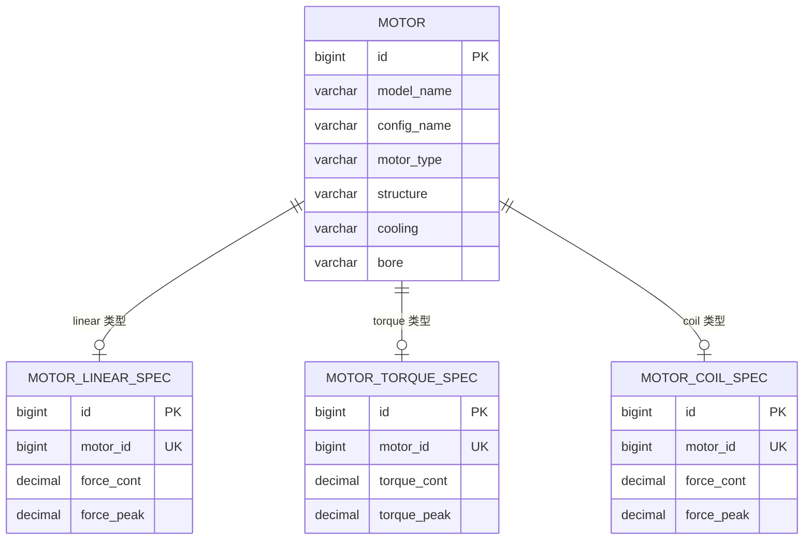

# 电机选型工具（MotorSizer）— 第三阶段：数据库设计

| 项 | 内容 |
|---|---|
| 文档类型 | 总体设计 · 第三阶段产出（数据设计） |
| 依据 | `doc/design/01.功能模块梳理.md`（M10/S1/K2）、`doc/design/02.整体架构设计.md`（H2 文件模式、只建电机域）、`doc/requirements.md` 第 6 章、`doc/rules/database-rules.md` |
| 建表脚本 | `scripts/sql/schema.sql` |
| 本阶段边界 | 只做表结构与约束；不含接口、不含业务代码、不含初始化数据 |
| 状态 | 待用户审核；第 7 章 4 项已全部确认，建表脚本已在真实 H2 环境实测通过（第 8 章） |

---

## 1. 设计范围与总体结论

### 1.1 范围

第一阶段的裁定把数据域收敛得非常窄：

| 数据 | 是否入库 | 依据 |
|---|---|---|
| **电机库**（三类型、三套规格） | **入库**（唯一持久化域） | 第一阶段 P0-3 / Q3=A |
| 项目 / 轴 / 方案 / 选定电机 | **不入库**（会话级，关页即失） | 第一阶段 Q3=A、需求 3.2、X-9 |
| 字段字典（三套模板、`req`、`factor`） | **不入库**（代码内定义 + API 下发） | 第二阶段 T-4 |
| 编码器与订购件 | **不建模** | 需求 6.2 第 3 档、第 9 章 |

> **因此最终只有 4 张表**：1 张主表 + 3 张规格表（按电机类型 1:1 拆分）。

### 1.2 为什么是 4 张表而不是 1 张宽表

| 方案 | 必填约束能否落地 | 单位语义 | 查询复杂度 |
|---|---|---|---|
| **主表 + 三规格表（选定）** | ✅ 每类必填字段可真正 `NOT NULL` | ✅ 各表独立，语义清晰 | 按类型 JOIN 对应表 |
| 单张宽表 | ❌ 跨类型字段只能可空，`NOT NULL` 无法分型表达 | ⚠️ 同名列承载不同单位 | 最低 |
| EAV 属性表 | ❌ 全部字符串，无法约束必填 | ❌ 无类型语义 | 需行转列 |

选定理由：`doc/rules/database-rules.md` R3-2 要求「必填字段应设置 `NOT NULL`」、R4-5 要求「数据库约束应作为重要防线」。单张宽表会让「直线电机必须有 `force_cont`、力矩电机必须有 `max_speed_peak`」这类**分类型必填规则**只能在应用层实现，数据库防线失效。

另有一处**强证据**支持拆表：同一个字段名在三套模板中语义不同——

| 字段 | 直线 | 力矩 | 音圈 |
|---|---|---|---|
| `Kf/Kt` 单位 | N/Arms | Nm/Arms | **N/A（单相）** |
| `R25` 单位 | Ω（相间） | Ω（相间） | **Ω（单相，非相间）** |
| `Icont` 单位 | Arms | Arms | **A（单相）** |
| `Ke` 单位 | Vpeak/(m/s) | Vpeak/rpm | V/(m/s) |

若并入一张表，同名列表将同时承载「相间电阻」与「单相电阻」——**这正是规则 R3-7「不得将多个独立业务值拼接到一个字段」所禁止的情形**。

---

## 2. 核心实体与关系

### 2.1 实体关系图

> 说明：上述关系为**逻辑关联**（`motor_id` 列），数据库层**不建物理外键**（规则 R4-2）。`||--o|` 表示 1:0..1——一条 `motor` 记录在其类型对应的规格表中恰好至多一条记录。

### 2.2 关系说明

| 关系 | 基数 | 实现方式 | 完整性由谁保证 |
|---|---|---|---|
| `motor` → `motor_linear_spec` | 1 : 0..1 | 规格表 `motor_id` + `UNIQUE(motor_id)` | 应用层：`motor_type='linear'` 时写入 |
| `motor` → `motor_torque_spec` | 1 : 0..1 | 同上 | 应用层：`motor_type='torque'` 时写入 |
| `motor` → `motor_coil_spec` | 1 : 0..1 | 同上 | 应用层：`motor_type='coil'` 时写入 |

**「类型 ↔ 规格表」的对应规则（应用层强制）：**

| `motor.motor_type` | 对应规格表 | 是否参与直线页 | 是否参与旋转页 |
|---|---|---|---|
| `linear` | `motor_linear_spec` | ✅ | ✗ |
| `coil` | `motor_coil_spec` | ✅（音圈按推力 N、速度 m/s 归直线页） | ✗ |
| `torque` | `motor_torque_spec` | ✗ | ✅ |

> 数据库层无法强制「linear 必有 linear_spec」，因规则 R4-2 禁止物理外键。**这是有意接受的一致性风险**，由 S1 电机库服务在保存时保证（见 6.2）。

---

## 3. 表结构设计

### 3.1 `motor` —— 电机主表

| 字段 | 类型 | 空 | 约束/说明 |
|---|---|---|---|
| `id` | `BIGINT` | NOT NULL | **主键**，`AUTO_INCREMENT`（规则 R4-1） |
| `model_name` | `VARCHAR(100)` | NOT NULL | 型号名，如 `ADR110-B136`、`DDR-080-气冷` |
| `config_name` | `VARCHAR(20)` | NOT NULL | 配置名（电气接法），CHECK 限定 `默认/串联/并联` |
| `motor_type` | `VARCHAR(10)` | NOT NULL | 类型，CHECK 限定 `linear/torque/coil` |
| `structure` | `VARCHAR(20)` | NOT NULL | 结构，CHECK 限定四类 |
| `cooling` | `VARCHAR(20)` | NOT NULL | 冷却，CHECK 限定 `普通/水冷/气冷` |
| `bore` | `VARCHAR(20)` | NULL | 中孔规格，仅力矩有值；CHECK 限定 `标准/特殊` |
| `manufacturer` | `VARCHAR(50)` | NULL | 厂商 |
| `series` | `VARCHAR(50)` | NULL | 系列 |
| `source_doc` | `VARCHAR(200)` | NULL | 样册文件名 |
| `source_page` | `VARCHAR(20)` | NULL | 页码 |
| `entry_method` | `VARCHAR(20)` | NOT NULL | 录入方式，CHECK 限定 `手工录入/识别草稿` |
| `entered_on` | `DATE` | NULL | 录入日期 |
| `note` | `VARCHAR(1000)` | NULL | 样册选型说明（人类可读，不参与计算与筛选） |
| `created_at` | `TIMESTAMP` | NOT NULL | 创建时间（UTC），默认当前时刻 |
| `updated_at` | `TIMESTAMP` | NOT NULL | 更新时间（UTC），应用层写入 |

**约束：**

| 约束名 | 类型 | 内容 |
|---|---|---|
| `uk_motor_model_config` | **唯一** | `(model_name, config_name)` —— 需求 6.1 的业务主键 |
| `ck_motor_type` | CHECK | `motor_type IN ('linear','torque','coil')` |
| `ck_motor_config` | CHECK | `config_name IN ('默认','串联','并联')` |
| `ck_motor_structure` | CHECK | `structure IN ('无铁芯','有铁芯','超声波力矩电机','音圈')` |
| `ck_motor_cooling` | CHECK | `cooling IN ('普通','水冷','气冷')` |
| `ck_motor_bore` | CHECK | `bore IS NULL OR bore IN ('标准','特殊')` |
| `ck_motor_entry` | CHECK | `entry_method IN ('手工录入','识别草稿')` |

**索引：** `idx_motor_type_structure_cooling (motor_type, structure, cooling)` —— 覆盖候选池取数（先按页签定类型，再按结构/冷却过滤，需求 7.3）。

### 3.2 `motor_linear_spec` —— 直线电机规格

必填 **10 项**全部 `NOT NULL`（需求 6.2 第 1 档 + 第 49 轮电流必填）。

| 分组 | 字段 | 类型 | 空 | 单位 |
|---|---|---|---|---|
| **必填** | `force_cont` | `DECIMAL(18,6)` | NOT NULL | N |
| | `force_peak` | `DECIMAL(18,6)` | NOT NULL | N |
| | `kf` | `DECIMAL(18,6)` | NOT NULL | N/Arms |
| | `ke` | `DECIMAL(18,6)` | NOT NULL | Vpeak/(m/s) |
| | `r25` | `DECIMAL(18,6)` | NOT NULL | Ω（相间） |
| | `i_cont` | `DECIMAL(18,6)` | NOT NULL | Arms |
| | `i_peak` | `DECIMAL(18,6)` | NOT NULL | Arms |
| | `t_max` | `DECIMAL(18,6)` | NOT NULL | °C |
| | `kth` | `DECIMAL(18,6)` | NOT NULL | W/°C |
| | `u_bus` | `DECIMAL(18,6)` | NOT NULL | Vdc |
| **选填·性能** | `km` / `l` / `te` / `pn` / `pole_pitch` / `mag_force` | `DECIMAL(18,6)` | NULL | 见脚本注释 |
| **选填·机械** | `mover_mass` / `coil_length` / `track_mass` | `DECIMAL(18,6)` | NULL | kg / mm / kg/m |
| **准入补充** | `max_speed_peak` / `max_speed_cont` | `DECIMAL(18,6)` | **NULL** | m/s |

> **`max_speed_*` 为何可空**：样册通常不提供该值；留空时**只跳过准入②**并注明「未校核」，不阻断推荐（第 43/44 轮）。若设为 `NOT NULL`，会复现「能入库却恒为信息不全」的旧缺陷。

**约束：** `uk_linear_spec_motor UNIQUE (motor_id)`（1:1）；索引 `idx_linear_spec_motor (motor_id)`。

### 3.3 `motor_torque_spec` —— 力矩电机规格

必填 **12 项**（比直线多双转速阈值，因力矩样册必填，需求 6.2）。

| 分组 | 字段 | 类型 | 空 | 单位 |
|---|---|---|---|---|
| **必填** | `torque_cont` / `torque_peak` | `DECIMAL(18,6)` | NOT NULL | Nm |
| | `kt` | `DECIMAL(18,6)` | NOT NULL | Nm/Arms |
| | `ke` | `DECIMAL(18,6)` | NOT NULL | Vpeak/rpm |
| | `r25` | `DECIMAL(18,6)` | NOT NULL | Ω（相间） |
| | `i_cont` / `i_peak` | `DECIMAL(18,6)` | NOT NULL | Arms |
| | `t_max` / `kth` / `u_bus` | `DECIMAL(18,6)` | NOT NULL | °C / W/°C / Vdc |
| | `max_speed_peak` / `max_speed_cont` | `DECIMAL(18,6)` | **NOT NULL** | rpm（准入②） |
| **选填** | `km` / `l` / `te` / `pn` / `poles` | `DECIMAL(18,6)` | NULL | — |
| **选填·机械** | `total_mass` / `inertia` / `runout_axial` / `runout_radial` / `load_axial_normal` / `load_axial_inverted` / `load_torque_normal` / `load_torque_inverted` | `DECIMAL(18,6)` | NULL | kg / kg·m² / μm / N / Nm |

> `poles`（极数）用 `DECIMAL(18,6)` 以保持数值类型统一；应用层按整数校验。**已确认保持 `DECIMAL(18,6)`（第 63 轮 Q1=A）**，不改 `INT`：极数不参与任何计算、仅作展示，类型统一可免去实体类的特例处理。

### 3.4 `motor_coil_spec` —— 音圈电机规格

必填 **10 项**，与直线数量相同但**语义为单相**。

| 分组 | 字段 | 类型 | 空 | 单位 |
|---|---|---|---|---|
| **必填** | `force_cont` / `force_peak` | `DECIMAL(18,6)` | NOT NULL | N |
| | `kf` | `DECIMAL(18,6)` | NOT NULL | **N/A（单相）** |
| | `ke` | `DECIMAL(18,6)` | NOT NULL | V/(m/s) |
| | `r25` | `DECIMAL(18,6)` | NOT NULL | **Ω（单相，非相间）** |
| | `i_cont` / `i_peak` | `DECIMAL(18,6)` | NOT NULL | **A（单相）** |
| | `t_max` / `kth` / `u_bus` | `DECIMAL(18,6)` | NOT NULL | °C / W/°C / Vdc |
| **选填·性能** | `stroke` / `km` / `l` / `te` / `pn` | `DECIMAL(18,6)` | NULL | mm / — / mH / ms / W |
| **选填·机械** | `mover_mass` / `core_mass` / `gap` | `DECIMAL(18,6)` | NULL | kg / kg / mm |
| **准入补充** | `max_speed_peak` / `max_speed_cont` | `DECIMAL(18,6)` | NULL | m/s |

> **单位换算（第 63 轮裁定）**：库中只存**内部单位**的已换算值。音圈的**线圈质量与铁芯质量**均按 g 录入、由 K2 的 `factor=0.001` 换算为 kg 后入库。
>
> ✅ **`core_mass` 缺口已闭合（Q4=A）**：原型 `data.js` 中 `coreMass` 原缺 `factor`，已补为 `factor: 0.001`，与 `moverMass` 口径一致（`prototype/js/data.js:400`）。

---

## 4. 删除策略与完整性

### 4.1 删除策略

| 场景 | 决策 | 依据 |
|---|---|---|
| 删除电机记录 | **v1 不提供**（只新增/编辑） | 第 63 轮裁定；需求 6.4 只写「新增/编辑」，原型无删除入口 |
| 逻辑删除（`deleted_at`） | **不引入** | 同上，不为未定义功能预留列 |
| 停用标记（`enabled`） | **不引入** | 同上 |
| 若后续新增删除 | 须在同一事务内删除 `motor` 及其规格行 | 见 4.3 孤儿行问题 |

### 4.2 完整性防线分层

| 层 | 检查内容 | 说明 |
|---|---|---|
| **数据库** | 唯一约束（型号+配置）、CHECK 枚举、NOT NULL 必填、1:1 唯一 | 规则 R4-5「重要防线」 |
| **服务端（S1）** | 类型↔规格表对应、规格表必填齐备、主键冲突提示、单位换算 | 规则 R4-3「应用层负责关联校验」 |
| **前端（M10）** | 即时提示、缺项标红、必填前置 | 第一阶段 P1/Q6「前端即时提示」 |

> **单点数据源（X-4 / C-B）**：三套模板的「必填清单」由代码内的 K2 字段字典（`req` 标记）驱动；**数据库的 `NOT NULL` 必须与 K2 的 `req` 集合严格一致**。两者不一致时，会出现「前端说必填、数据库说可空」或反之。此为下文 6.3 的核对项。

### 4.3 已知的一致性缺口（物理外键被禁用导致）

规则 R4-2 禁止物理外键，故数据库**无法阻止**下列脏数据。每项缺口都必须有明确的防线，**不能留白**：

| 缺口 | 后果 | 防线（在哪一层保证） |
|---|---|---|
| 有 `motor` 无对应规格行 | 该电机无法判定（判为信息不全） | **S1 同一事务写入主表 + 规格表**（事务边界见 `04.API接口设计.md` C3「事务边界」节） |
| 有规格行无 `motor`（孤儿） | 数据冗余，占用空间 | v1 无删除功能；若未来提供删除，须在同一事务内级联删除 |
| `motor_type='linear'` 却写进 `motor_torque_spec` | 判定逻辑读到错误参数 | **S1 按 `motor_type` 路由写入**（字段白名单校验见 `04.API接口设计.md` C3 规则 2）；S3 读取时也按类型路由 |
| 两条规格行指向同一 `motor` | — | `UNIQUE(motor_id)` 已在数据库层阻止 |
| 前端把 `derived` 派生值写回 | 污染只读派生数据 | C3 规则 8 明确拒绝含 `spec.derived` 的请求（`400`） |

> **职责划分的总原则**：**数据库只保证它能保证的**（唯一、CHECK、NOT NULL）；**类型↔规格表的对应关系由服务端唯一负责**——因为规则 R4-2 主动放弃了外键这一工具。这两份文档（03 与 04）在此点上互为引用，不存在职责真空。

---

## 5. 设计合规核对

对照 `doc/rules/database-rules.md` 逐条核对：

| 规范条目 | 要求 | 本设计 | 结论 |
|---|---|---|---|
| R2-1 | `snake_case` 命名 | 全部表名/字段名均为 snake_case | ✅ |
| R2-2 | 避免拼音、无意义缩写 | `kf` / `ke` / `kth` / `r25` 为**行业标准符号**（力常数/反电势常数/热耗散常数/25°C电阻），非缩写 | ✅（见 5.1 说明） |
| R2-3 | 表名单复数风格统一 | 全部单数（`motor`、`motor_linear_spec`） | ✅ |
| R2-4 | 主键 `id`；关联实体 `<entity>_id` | `id`；`motor_id` | ✅ |
| R2-5 | 时间字段语义明确 | `created_at` / `updated_at` / `entered_on` | ✅ |
| R2-6 | 避免数据库保留字 | 已检查：无 `order`/`group`/`check`/`key` 等 | ✅ |
| R3-1 | 类型准确表达含义 | 数值 `DECIMAL(18,6)`、枚举 `VARCHAR`+CHECK、日期 `DATE`/`TIMESTAMP` | ✅（见 5.2 精度说明） |
| R3-2 | 必填 `NOT NULL` | 三套规格表的必填项均 `NOT NULL` | ✅（见 6.3 核对） |
| R3-3 | 默认值不得掩盖缺失 | 仅时间字段用 `CURRENT_TIMESTAMP`；**无**「参数默认 0」 | ✅ |
| R3-4 | 精确计算用定点类型 | 全部 `DECIMAL`，无 `DOUBLE`/`FLOAT` | ✅（见 5.2 精度损失） |
| R3-5 | 时间统一时区策略 | 全部 UTC 存储，展示层转换 | ✅ |
| R3-6 | 状态字段有限取值集 | 6 个 CHECK 约束 | ✅ |
| R3-7 | 不拼接独立业务值 | 拆三张规格表，避免同名列承载不同单位 | ✅ |
| R4-1 | 自增主键 | `BIGINT AUTO_INCREMENT` | ✅ |
| R4-2 | 禁止物理外键 | 无 `FOREIGN KEY` | ✅ |
| R4-3 | 逻辑关联 + 应用层校验 | `motor_id` 逻辑关联 | ✅ |
| R4-4 | 业务唯一值用唯一约束 | `uk_motor_model_config` + 三个 `uk_*_spec_motor` | ✅ |
| R4-5 | 数据库约束作为防线 | 唯一 + CHECK + NOT NULL | ✅（分类型约束受 R4-2 限制，见 4.3） |

### 5.1 关于「缩写」的说明

`kf`、`ke`、`kth`、`r25`、`i_cont`、`u_bus`、`km`、`te` 不是随意缩写，而是**电机工程领域的标准符号**（与厂商样册、参考选型软件的标注一致）。它们的含义已在 `COMMENT` 中逐一说明，并与代码内字段字典 K2 的 `key` 一一对应——若改成 `force_constant`、`back_emf_constant`，反而与样册和 K2 脱节，违背 X-4「字段字典唯一来源」。

### 5.2 关于精度损失的说明

统一 `DECIMAL(18,6)` 的已知损失：

| 参数 | 实际值 | 存储值 | 相对误差 | 影响 |
|---|---|---|---|---|
| 转动惯量 `inertia` | `4.419e-4` | `0.000442` | 0.023% | **无**——第 45 轮已不再叠加电机惯量，该值仅作展示 |
| 其余参数（推力 0.86 ~ 电阻 8.8 ~ 电压 600） | — | — | < 0.001% | 无 |

> 若后续有参数需要更高精度（如极小电感），需整体评估（见待确认 Q2）。

---

## 6. 与业务需求的对应核对

### 6.1 覆盖核对

| 需求条目 | 数据落点 | 状态 |
|---|---|---|
| 6.1 主键 = 型号名 + 配置名 | `uk_motor_model_config` | ✅ |
| 6.1 配置为电气接法（第 62 轮） | `config_name` CHECK | ✅ |
| 6.1 冷却/结构为中孔为独立属性 | `structure` / `cooling` / `bore` 独立列 | ✅ |
| 6.1 同型号不同冷却按两条记录（P2-5 写型号名） | `model_name` 承载差异 + 唯一约束允许共存 | ✅ |
| 6.2 三套字段模板（直线 10 / 力矩 12 / 音圈 10 必填） | 三张规格表，字段一一对应 | ✅ |
| 6.2 `Km` 留空可派生 | `km` 可空 | ✅ |
| 6.2 直线/音圈最高速度可空（跳过准入②） | `max_speed_*` 可空 | ✅ |
| 6.2 力矩双转速必填 | `max_speed_*` NOT NULL | ✅ |
| 6.2 音圈行程仅展示 | `stroke` 可空 + 不参与判定 | ✅ |
| 6.3 来源信息 | 主表 6 列 | ✅ |
| 6.3 测试条件 | **由 K2 模板定义，不入列**（第 63 轮裁定） | ✅ |
| 6.4 手工录入 | `entry_method='手工录入'` | ✅ |
| 6.4 音圈 g→kg 换算 | `mover_mass` / `core_mass` 均存 kg，换算在 K2 | ✅ `core_mass` 的 factor 已补（Q4=A） |
| 第 9 章 编码器不入库 | 无相关字段 | ✅ |

### 6.2 类型↔规格表的一致性是**应用层职责**

数据库层无法强制（R4-2 禁物理外键）。完整的校验规则与事务边界定义在 **`04.API接口设计.md` C3 的「规格字段校验」与「事务边界」两节**——包括字段白名单、类型必填差异、`derived` 拒收、`BEGIN/COMMIT/ROLLBACK` 的完整流程。

本文档不重复该规则，避免两处定义漂移；此处只声明职责归属：

| 层 | 职责 |
|---|---|
| 数据库 | 唯一约束（`uk_motor_model_config`、`uk_*_spec_motor`）、CHECK、NOT NULL |
| **服务端 S1** | 类型↔规格表路由、字段白名单、必填集（读 K2 `req`）、事务原子性 |
| 前端 M10 | 即时提示（必填星标、缺项标红） |

### 6.3 `NOT NULL` 与 K2 `req` 的严格对齐（关键核对项）

| 规格表 | 数据库 NOT NULL 字段数 | K2 `req` 字段数 | 是否一致 |
|---|---|---|---|
| `motor_linear_spec` | 10 | 10（第 49 轮定稿） | ✅ |
| `motor_torque_spec` | 12 | 12（第 49 轮定稿） | ✅ |
| `motor_coil_spec` | 10 | 10（第 49 轮定稿） | ✅ |

> **这是必须长期守住的不变量**：任何一侧新增必填项，另一侧必须同步，否则「保存门槛 = 准入门槛 = 星标」的单一数据源约束（C-B）会被破坏。

### 6.4 漂移防护单测（第 66 轮 Q11=A，必须实现）

> 手工核对不可靠——两侧分属"Java 常量"与"SQL 脚本"，改动时极易只改一处。用自动化测试锁死该不变量。

**测试设计：**

| 项 | 要求 |
|---|---|
| 位置 | `motorsizer-app/src/test/java/.../SchemaTemplateConsistencyTest` |
| 前置 | 启动嵌入式 H2（内存模式），执行 `classpath:db/schema.sql` |
| 读取 DDL | 查 `INFORMATION_SCHEMA.COLUMNS`，取各规格表 `IS_NULLABLE='NO'` 且**非** `id`/`motor_id`/`created_at`/`updated_at` 的列 |
| 读取 K2 | 遍历 `motorsizer-domain` 中三套模板，取 `required=true` 的字段 `key` |
| 比对 | 两个集合必须**完全相等**（双向断言：DDL 有而 K2 无 → 失败；K2 有而 DDL 无 → 失败） |
| 命名映射 | DDL 的 `snake_case` → API/DTO 的 `lowerCamelCase`，复用同一映射工具（见 `04.API接口设计.md` 4.1） |
| 失败信息 | 明确列出缺失的字段名与所属表，便于定位 |

**同批应一并覆盖的断言：**

| # | 断言 | 对应风险 |
|---|---|---|
| 1 | 三套规格表的 `NOT NULL` 集合 = K2 的 `req` 集合 | D-2 |
| 2 | `motor` 的 CHECK 取值集 = K2 模板的 `structures`/`coolings`/`configs`/`bores` 取值集 | 枚举两处漂移 |
| 3 | `uk_motor_model_config` 存在 | 规则 R4-4 业务唯一约束 |
| 4 | `schema.sql` 可重复执行且不报错 | 第 63 轮已验证的幂等性 |

---

## 7. 待确认问题

### 7.1 本轮确认记录（已定）

| # | 问题 | 用户裁定 | 落地 |
|---|---|---|---|
| **Q1** | 极数 `poles` 类型 | **A：保持 `DECIMAL(18,6)`** | 与其余数值字段类型统一，MyBatis-Plus 映射无需特例；应用层校验为整数；极数不参与计算仅作展示 |
| **Q2** | 数值精度 | **A：保持 `DECIMAL(18,6)`** | 惯量已不参与任何计算（第 45 轮），0.023% 截断仅影响展示；与已确认方案一致 |
| **Q3** | 厂商/系列是否独立表 | **A：保持主表列** | v1 无按厂商/系列筛选或统计的需求；不擅自增加未定义结构 |
| **Q4** | 音圈铁芯质量单位 | **A：补 `factor: 0.001`，按 kg 入库** | **已修正原型** `prototype/js/data.js:400`；与线圈质量口径一致 |

> **Q4 的连带确认**：`source_page` 保持 `VARCHAR(20)`（容纳「第 3 页 / P.12 / 附页」等非纯数字形式）；`{cool}` 冷却条件占位符**不入库**（是标签文字，非数据值），而**冷却方式本身**已作为 `motor.cooling` 独立列入库——两者不冲突。

### 7.2 已确认为「无需动作」的事项

| # | 事项 | 结论 |
|---|---|---|
| — | `source_page` 是否改 `INT` | 保持 `VARCHAR(20)`：样册页码存在非纯数字形式，改整型会丢失信息 |
| — | 是否建「厂商 + 系列」索引 | 暂不建：v1 无按厂商/系列筛选需求（候选仅按结构/冷却过滤）。需求出现时可加 |
| — | `{cool}` 占位符是否入库 | 不入库；冷却方式已独立列为 `motor.cooling` |

### 7.3 已知风险（非阻塞）

| # | 风险 | 等级 | 说明 |
|---|---|---|---|
| D-1 | 类型↔规格表错配无法由数据库阻止 | 中 | R4-2 禁物理外键的必然结果；由 S1 事务写入 + S3 按类型路由读取兜底；建议第四阶段在 API 契约中明确 |
| D-2 | `NOT NULL` 与 K2 `req` 漂移 | 中 | 两侧需同步维护。**已确定加回归单测（第 66 轮 Q11=A）**：单测启动内存 H2 执行 `schema.sql`，读 `INFORMATION_SCHEMA.COLUMNS` 的 `IS_NULLABLE`，与 K2 三套模板的 `req` 集合逐一比对；不一致时构建失败。实现要求见 6.4 |
| D-3 | `DECIMAL(18,6)` 精度 | 低 | 当前无影响（惯量不参与计算）；若恢复叠加电机惯量则需提升 |
| D-4 | 无初始化数据，首启空库 | 低 | 第 63 轮已定（Q3=A）；用户需自行录入，M7 显示引导文案 |

---

## 8. 建表脚本执行验证（实测）

> 为验证 `scripts/sql/schema.sql` 在目标环境真实可执行，使用 **Docker + `eclipse-temurin:17-jre-alpine` + H2 2.2.224**，连接串与生产一致：
> `jdbc:h2:file:...;MODE=MySQL;AUTO_SERVER=TRUE`。

### 8.1 结构建成情况

| 表 | 列数 | 主键 | 业务唯一 | CHECK |
|---|---|---|---|---|
| `motor` | 16 | ✅ | `uk_motor_model_config` | 6 个 |
| `motor_linear_spec` | 25 | ✅ | `uk_linear_spec_motor` | — |
| `motor_torque_spec` | 29 | ✅ | `uk_torque_spec_motor` | — |
| `motor_coil_spec` | 24 | ✅ | `uk_coil_spec_motor` | — |

### 8.2 约束行为实测

| # | 测试用例 | 预期 | 实测结果 |
|---|---|---|---|
| T1 | 合法插入直线电机（主表 + 规格表） | 成功 | ✅ 两表各 1 条 |
| T2 | 重复 `(model_name, config_name)` | 拒绝 | ✅ `Unique index violation: UK_MOTOR_MODEL_CONFIG` |
| T3 | 非法 `motor_type='servo'` | 拒绝 | ✅ `Check constraint violation: CK_MOTOR_TYPE` |
| T4 | 非法 `cooling='油冷'` | 拒绝 | ✅ `Check constraint violation: CK_MOTOR_COOLING` |
| T5 | 规格表缺 `force_cont` | 拒绝 | ✅ `NULL not allowed for column "FORCE_CONT"` |
| T6 | 同一 `motor_id` 插两条规格 | 拒绝 | ✅ `Unique index violation: UK_LINEAR_SPEC_MOTOR` |
| T7 | 直线电机 `max_speed_peak` 留空 | **允许** | ✅ 无报错（符合第 43/44 轮「留空跳过准入②」） |
| T8 | 中文 `COMMENT` 是否入库 | 可读 | ✅ 检出「型号名，如 ADR110-B136、DDR-080-气冷」 |
| T9 | 脚本重复执行（幂等性） | 无报错且数据保留 | ✅ 二次执行成功，已有 2 条主表 + 2 条规格 |

### 8.3 验证结论

| 关注点 | 结论 |
|---|---|
| H2 `MODE=MySQL` 是否支持 `COMMENT '...'` | ✅ 支持（此前的疑虑已排除） |
| `AUTO_INCREMENT` 主键 | ✅ 正常 |
| 中文 CHECK 取值（如 `'默认'`、`'无铁芯'`） | ✅ 正常匹配与拒绝 |
| `IF NOT EXISTS` 幂等性 | ✅ 可重复执行，`spring.sql.init.mode=always` 安全 |
| 规则 R4-4「业务唯一用唯一约束」 | ✅ 由数据库强制，非仅应用层 |

> **验证方式的可复现性（第 67 轮评审定案）**：本次验证依赖 Docker 与临时 H2 jar，未在仓库中保留脚本与产物（`scripts/tmp` 已清理），**属一次性验证，不能防止 regression**。
>
> 因此 **§6.4 的 `SchemaTemplateConsistencyTest` 必须同时承担 schema 执行验证**：单测启动内存 H2 执行 `classpath:db/schema.sql`，即自动覆盖本节的 T1–T9 全部行为（建表成功、约束生效、幂等性）。两者合并为一个测试类，断言清单见 §6.4 的 4 项。
>
> 本节的 Docker 实测记录保留，作为**首次验证的证据**与「H2 在 `MODE=MySQL` 下确实支持中文 COMMENT / CHECK」这一结论的依据——该结论进入单测后仍成立，但不再依赖人工复现。

---

## 9. 本阶段快照

**已确认的数据库决策（本轮交互 + 前序阶段）**

1. 只建**电机域**：4 张表（1 主表 + 3 规格表），无项目/方案/字段字典表。
2. 表形态：**主表 + 三类规格表 1:1**，使分类型必填可用 `NOT NULL` 落地（R3-2 / R4-5）。
3. 主键：`BIGINT AUTO_INCREMENT` + `UNIQUE(model_name, config_name)`。
4. 不建物理外键（R4-2）；`motor_id` 逻辑关联。
5. 数值统一 `DECIMAL(18,6)`；只存内部单位，换算在 K2。
6. 枚举用 `VARCHAR` + `CHECK` 约束（与 K2 的 key 一致）。
7. 来源信息作为主表列。
8. **v1 不提供删除/停用**，不加 `deleted_at` / `enabled` 列。
9. 测试条件不入列，由 K2 字段模板定义。
10. **脚本已在真实 H2 环境验证通过**（9 项用例，见第 8 章）。

**第 63 轮交互确认（4 项）**

11. ~~Q1 极数类型~~ ✅ 保持 `DECIMAL(18,6)`、~~Q2 精度~~ ✅ 保持 `(18,6)`、~~Q3 厂商/系列~~ ✅ 保持主表列、~~Q4 铁芯质量单位~~ ✅ 补 `factor: 0.001` 按 kg 入库（原型已修正）。
12. **本阶段无剩余待确认项**。数据库设计、建表脚本、脚本实测验证三部分齐备，可进入下一阶段。

**与前序阶段的文档同步**

13. `prototype/js/data.js:400`（`coreMass` 的 `factor`）已按 Q4 裁定修正。
14. 需求 6.3 的「测试条件随参数入库」已由第 63 轮裁定改为「由 K2 字段模板定义」，本轮无需再改需求文档（第一阶段已修订）。

**第 66 轮补充确认（1 项）**

15. ~~Q11 漂移防护~~ ✅ **加回归单测**：见 6.4，共 4 项断言（必填集合、枚举集、唯一约束、脚本幂等）。该测试是「保存门槛 = 准入门槛 = 星标」不变量（C-B）的机器化保障。
